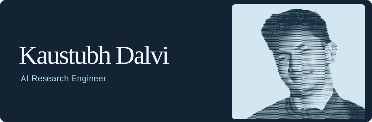

<h1 align="center">
  <picture>
    <source media="(max-width: 740px)" srcset="https://raw.githubusercontent.com/Kaustubhdalvi/Kaustubhdalvi/main/assets/profile-masthead-compact.svg">
    
  </picture>
</h1>

I build reinforcement learning environments for coding agents and write the Python tests that score their work. When a score surprises me, I trace the agent’s steps to see what the test rewarded.

I’m exploring how mixtures of specialized models can work together in the next generation of computing.

  
  

  
  

## Pip’s yard

<!-- yard:start -->
<picture>
  <source media="(prefers-reduced-motion: no-preference)" srcset="https://raw.githubusercontent.com/Kaustubhdalvi/Kaustubhdalvi/main/assets/pip-ball-yard.gif">
  
</picture>

<!-- yard:end -->

<!-- community:start -->

**Bookshelf** · 

Garden leaderboard · 0 recorded visits

The first credited visit will appear here.

<!-- community:end -->

<picture>
  <source media="(prefers-reduced-motion: no-preference)" srcset="https://raw.githubusercontent.com/Kaustubhdalvi/Kaustubhdalvi/main/assets/wave.svg">
  
</picture>
