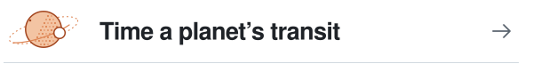

# Kaustubh Dalvi

My work in AI research engineering focuses on measuring what coding agents can do. I build reinforcement learning environments, run reproducible evaluations, and audit the Python graders. When a score surprises me, I trace the agent’s actions to see what the benchmark actually rewarded.

[Puzzle notebook](https://kaustubhdalvi.github.io/Kaustubhdalvi/puzzles.html) · [LinkedIn](https://www.linkedin.com/in/kaustubhdalvi02/)

<picture>
  <source media="(prefers-reduced-motion: no-preference)" srcset="https://raw.githubusercontent.com/Kaustubhdalvi/Kaustubhdalvi/main/assets/pip-ball-yard.gif">
  
</picture>

## Self portrait in type

<table align="center">
<tr><td>

```text
                                            .....       . .
                                  .:....:......   . .. . .  .   . .
                               .::...... . .   .       . .   .        . .
                            ::..       . . . .  . . . .   .   .       .   .
                           ;:  . .  ... .  .  .         . . . .  .  .   .  .
                          ::..    ........        ....:.::::::.      . .     .
                         ;... . ....... ... ....:..:::;;;;;;:;::...... ... . .
                        ::...................::::;++ccc+cc+cc+c++;:.:..........
                         :::...........:.:.:;;++ccccccccccccccccccc+:..:..... ..
                          :::.:....::::;:;+c+cccccccx*xxxxxxxxxxxxxcccc+;;:.....
                           .::.. ::::;;+ccccccccccxccxxx****xxxxxxx*xxxxccc;;:.
                             :.:..;:;;;c+c+cccccccxx*o&&oxccccxxxxxxxxcxcc+c++:+xxcc+
                              :::::;;;++cccccxxxxxooa*cccccx&&aoaoo***xxxcc;cx*&▒▒ao*x
                               .:::;;++cccxxx**o***xccccccxcccccccx***o**xc;xao*o&&*aac
                                 .;;;;c+++cc+cccc*a*xxxcccc+ccxxcx**o*oo*xxcc**oaxooo*
                                  :;:::+cc+cc+c;+coo**xxcccx***ooa&&aaoo**xxcca&▒axo&c
                                   ;+cccccc+cccc.cx***x**ooo***ooa&&&aaoo*xxcc***a*o&
                                    c+c;;c+ccxcc:cxx*o****ao*ooa&&@#&&oo**xxccxo##aa
                                    :c++cccxcxx+:cc****xxx*ao*o*a###&ao*o**xxccccc
                                     :cccccx*oo;;ccoaaooao**aaao*oooooo*o***xccc
                                      +++c**o#c;cccxoo*oo*x*oooooxx*ooaoooooxccxc
                                      :cccx*o&c;++:+ccccx*****xxc+c*aaoooaoxxccxx
                                       ;cccxxxccc+ccccccccxcccccxx*oo*oooo*xxcxc*
                                         ccccccc+;;++cccxx*ao*oaa&&aoooo**xxccx**c
                                          ++ccc**c;+cccxcxx*oaaa&aaaaa**xxccc*oooo
                                            ++cccxcccccxxcxx**oaaaaa*xccxcxc*oaooac
                                              ;+cccccxccxxx*o&#ao**ccccxxcx*o&&aaox
                                               :;;++c+ccx**xcxcccc+ccccxcx*&&&&a&ooc:
                                                .++;;:;;+cccc+cccccccxx**a&##&&&&&#c++
                                                ..:.:.:.;;++ccccccxxooooa&&#&#&#&▒ac;++:
                                               .+.:+++;;;:;+cccx*a&&&aaaa&###&#▒▒*+;;+;c+:
                                         ;++:.: ++;ccxxxccccccxx*oaa&&&&####&#▒oc::++;;ccc+:.
                                    +c+cc+cc::;..c;ccxxxxccccxx*ooa&########▒▒c;;;++;+c+c+c+.:......
                               +c+cc+cc+c+c+:;:; :c+ccx**o****oa&@@@@▒▒▒▒▒▒▒a+;;;+++cc+ccc+;::.:.:..:....
                          +c+cc+cc+cc+c+cc+c::;+: :++ccxccccccccc+c+cccc*aax::;;+c+c+cc++;;;;::.:.:..........
                     +c+cc+cc+c+c+c+cc+c+cc+c;;;+;:..::;;;;++..;;++;;;;:::..;;++c+cc+++;;;;+;;::.:.:.:..:.....
                 +cc+c+c+cc+cc+cc+cc+cccc+c++;;::;;+;;:::::;++:;;+c+++;;;;++cc+ccc++;;;;;;;;+;;:...:........:.
             ;cccc+c+ccc+c+c+cc+cc+cc+c++;;;;;+;;;;:;++++;;;;+;;c:+++;++c+cc++++;;;;;;;;;;;;;+;;::..:..:..:...
```

</td></tr>
</table>

<a name="science-puzzles"></a>

## Puzzle notebook

<p>
<a href="https://kaustubhdalvi.github.io/Kaustubhdalvi/puzzles.html#transit"><picture><source media="(prefers-color-scheme: dark)" srcset="https://raw.githubusercontent.com/Kaustubhdalvi/Kaustubhdalvi/main/assets/menu-transit-dark.svg"><source media="(prefers-color-scheme: light)" srcset="https://raw.githubusercontent.com/Kaustubhdalvi/Kaustubhdalvi/main/assets/menu-transit-light.svg"></picture></a><br>
<a href="https://kaustubhdalvi.github.io/Kaustubhdalvi/puzzles.html#qubits"><picture><source media="(prefers-color-scheme: dark)" srcset="https://raw.githubusercontent.com/Kaustubhdalvi/Kaustubhdalvi/main/assets/menu-qubits-dark.svg"><source media="(prefers-color-scheme: light)" srcset="https://raw.githubusercontent.com/Kaustubhdalvi/Kaustubhdalvi/main/assets/menu-qubits-light.svg"></picture></a><br>
<a href="https://kaustubhdalvi.github.io/Kaustubhdalvi/puzzles.html#coin"><picture><source media="(prefers-color-scheme: dark)" srcset="https://raw.githubusercontent.com/Kaustubhdalvi/Kaustubhdalvi/main/assets/menu-coin-dark.svg"><source media="(prefers-color-scheme: light)" srcset="https://raw.githubusercontent.com/Kaustubhdalvi/Kaustubhdalvi/main/assets/menu-coin-light.svg"></picture></a><br>
<a name="which-run-would-you-ship"></a><a href="https://kaustubhdalvi.github.io/Kaustubhdalvi/puzzles.html#weather"><picture><source media="(prefers-color-scheme: dark)" srcset="https://raw.githubusercontent.com/Kaustubhdalvi/Kaustubhdalvi/main/assets/menu-weather-dark.svg"><source media="(prefers-color-scheme: light)" srcset="https://raw.githubusercontent.com/Kaustubhdalvi/Kaustubhdalvi/main/assets/menu-weather-light.svg"></picture></a>
</p>
