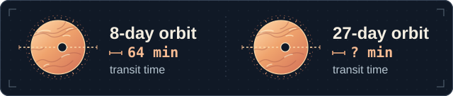
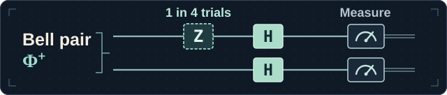

# Kaustubh Dalvi

My work in AI research engineering focuses on measuring what coding agents can do. I build reinforcement learning environments, run reproducible evaluations, and audit the Python graders. When a score surprises me, I trace the agent’s actions to see what the benchmark actually rewarded.

[Science puzzles](#science-puzzles) · [Coding challenge](#which-run-would-you-ship) · [LinkedIn](https://www.linkedin.com/in/kaustubhdalvi02/)

<picture>
  <source media="(prefers-reduced-motion: no-preference)" srcset="https://raw.githubusercontent.com/Kaustubhdalvi/Kaustubhdalvi/main/assets/pip-ball-yard.gif">
  
</picture>

## Self portrait in type

<table align="center">
<tr><td>

```text
                                            .....       . .
                                  .:....:......   . .. . .  .   . .
                               .::...... . .   .       . .   .        . .
                            ::..       . . . .  . . . .   .   .       .   .
                           ;:  . .  ... .  .  .         . . . .  .  .   .  .
                          ::..    ........        ....:.::::::.      . .     .
                         ;... . ....... ... ....:..:::;;;;;;:;::...... ... . .
                        ::...................::::;++ccc+cc+cc+c++;:.:..........
                         :::...........:.:.:;;++ccccccccccccccccccc+:..:..... ..
                          :::.:....::::;:;+c+cccccccx*xxxxxxxxxxxxxcccc+;;:.....
                           .::.. ::::;;+ccccccccccxccxxx****xxxxxxx*xxxxccc;;:.
                             :.:..;:;;;c+c+cccccccxx*o&&oxccccxxxxxxxxcxcc+c++:+xxcc+
                              :::::;;;++cccccxxxxxooa*cccccx&&aoaoo***xxxcc;cx*&▒▒ao*x
                               .:::;;++cccxxx**o***xccccccxcccccccx***o**xc;xao*o&&*aac
                                 .;;;;c+++cc+cccc*a*xxxcccc+ccxxcx**o*oo*xxcc**oaxooo*
                                  :;:::+cc+cc+c;+coo**xxcccx***ooa&&aaoo**xxcca&▒axo&c
                                   ;+cccccc+cccc.cx***x**ooo***ooa&&&aaoo*xxcc***a*o&
                                    c+c;;c+ccxcc:cxx*o****ao*ooa&&@#&&oo**xxccxo##aa
                                    :c++cccxcxx+:cc****xxx*ao*o*a###&ao*o**xxccccc
                                     :cccccx*oo;;ccoaaooao**aaao*oooooo*o***xccc
                                      +++c**o#c;cccxoo*oo*x*oooooxx*ooaoooooxccxc
                                      :cccx*o&c;++:+ccccx*****xxc+c*aaoooaoxxccxx
                                       ;cccxxxccc+ccccccccxcccccxx*oo*oooo*xxcxc*
                                         ccccccc+;;++cccxx*ao*oaa&&aoooo**xxccx**c
                                          ++ccc**c;+cccxcxx*oaaa&aaaaa**xxccc*oooo
                                            ++cccxcccccxxcxx**oaaaaa*xccxcxc*oaooac
                                              ;+cccccxccxxx*o&#ao**ccccxxcx*o&&aaox
                                               :;;++c+ccx**xcxcccc+ccccxcx*&&&&a&ooc:
                                                .++;;:;;+cccc+cccccccxx**a&##&&&&&#c++
                                                ..:.:.:.;;++ccccccxxooooa&&#&#&#&▒ac;++:
                                               .+.:+++;;;:;+cccx*a&&&aaaa&###&#▒▒*+;;+;c+:
                                         ;++:.: ++;ccxxxccccccxx*oaa&&&&####&#▒oc::++;;ccc+:.
                                    +c+cc+cc::;..c;ccxxxxccccxx*ooa&########▒▒c;;;++;+c+c+c+.:......
                               +c+cc+cc+c+c+:;:; :c+ccx**o****oa&@@@@▒▒▒▒▒▒▒a+;;;+++cc+ccc+;::.:.:..:....
                          +c+cc+cc+cc+c+cc+c::;+: :++ccxccccccccc+c+cccc*aax::;;+c+c+cc++;;;;::.:.:..........
                     +c+cc+cc+c+c+c+cc+c+cc+c;;;+;:..::;;;;++..;;++;;;;:::..;;++c+cc+++;;;;+;;::.:.:.:..:.....
                 +cc+c+c+cc+cc+cc+cc+cccc+c++;;::;;+;;:::::;++:;;+c+++;;;;++cc+ccc++;;;;;;;;+;;:...:........:.
             ;cccc+c+ccc+c+c+cc+cc+cc+c++;;;;;+;;;;:;++++;;;;+;;c:+++;++c+cc++++;;;;;;;;;;;;;+;;::..:..:..:...
```

</td></tr>
</table>

## Science puzzles

**[Play all four challenges with instant feedback →](https://kaustubhdalvi.github.io/Kaustubhdalvi/puzzles.html)**

Pick an illustration to play that question, or make a prediction here and open the explanation.

### Astrophysics · How long does the shadow last?

[](https://kaustubhdalvi.github.io/Kaustubhdalvi/puzzles.html#transit)

Two planets orbit the same star every **8 days** and **27 days**. Both cross the center of the star’s disk. The inner planet takes **64 minutes** from one edge to the other. Treat each planet as a point on a circular, edge-on orbit and each crossing as a straight line at its mid-transit speed.

**How long does the outer planet take?** 64 minutes, 96 minutes, or 216 minutes?

<details>
<summary>Check the transit time</summary>

**96 minutes.** Both planets travel one stellar diameter during transit. Kepler’s third law gives orbital radii in the ratio 9 to 4 for periods of 27 and 8 days. Divide each orbital circumference by its period and the outer planet moves at **two-thirds** of the inner planet’s speed. The crossing takes 64 × 3/2 = 96 minutes.

</details>

### Quantum computing · Can two fair bits hide an error?

[](https://kaustubhdalvi.github.io/Kaustubhdalvi/puzzles.html#qubits)

Start with the Bell pair `(|00⟩ + |11⟩)/√2`. In one quarter of otherwise ideal trials, a Z gate flips the phase on the first qubit. Apply a Hadamard to each qubit and measure both in the computational basis. Each bit on its own still looks perfectly fair.

**How often do the two bits match?** Half the trials, three quarters, or every trial?

<details>
<summary>Check the measurement odds</summary>

**Three quarters.** In a clean trial, the two Hadamards restore the original Bell pair, so the result is `00` or `11`. A phase flip changes the plus sign to a minus. The Hadamards then produce `(|01⟩ + |10⟩)/√2`. Every flipped trial gives opposite bits. Looking at the two readings together exposes the error.

</details>

### Mathematics · Which coin pattern wins the race?

[](https://kaustubhdalvi.github.io/Kaustubhdalvi/puzzles.html#coin)

Flip a fair coin independently until **HHT** or **HTH** first appears on three consecutive tosses. Each pattern has a 1/8 chance in any fixed window of three. You're betting on HHT.

**What’s your chance of winning?** One third, one half, or two thirds?

<details>
<summary>Check the winning odds</summary>

**Two thirds.** Start at the first H. If the next toss is H, the next T guarantees HHT. If the next two tosses are TH, then HTH wins. If they’re TT, the race resets. Each attempt therefore gives HHT a 1/2 chance to win, HTH a 1/4 chance, and a 1/4 chance to start over. Among attempts that decide the race, HHT wins twice as often as HTH.

</details>

[Check all three predictions with Python](https://github.com/Kaustubhdalvi/Kaustubhdalvi/blob/main/examples/puzzle_checks.py)

## Which run would you ship?

[](https://kaustubhdalvi.github.io/Kaustubhdalvi/puzzles.html#weather)

You’re reviewing a weather-feed merge. All three runs return **three rows totaling 16 °C**. Only one preserves the source readings.

| Local feed · UTC+05:30 | UTC feed |
| --- | --- |
| Jan 7, 05:28 · N · 4 °C | Jan 6, 23:58 · NORTH · 4 °C |
| Jan 7, 05:30 · S · 7 °C | Jan 7, 00:00 · NORTH · 5 °C |

Convert to UTC and expand the station names to NORTH and SOUTH. Merge matching readings for the same station and instant. Reject conflicting values for that pair. Keep both stations at a shared instant and sort by time, then station. These fictional readings use whole minutes.

**Which run passes review?** All three put NORTH at 4 °C at 23:58 UTC. Pick the right date for that row and the right midnight temperatures (NORTH / SOUTH) for Jan 7.

<details>
<summary><strong>Ship A</strong> · Jan 7 at 23:58 · midnight 5° / 7°</summary>

**Check the date.** Subtract 5 hours 30 minutes from Jan 7 at 05:28. That puts the first NORTH reading two minutes before the start of Jan 7. A places it a full day late. Try another run.

</details>

<details>
<summary><strong>Ship B</strong> · Jan 6 at 23:58 · midnight 5° / 7°</summary>

**Ship it.** Both feeds describe the same 4 °C NORTH reading at 23:58 UTC on Jan 6. At midnight, the UTC feed gives NORTH 5 °C and the local feed gives SOUTH 7 °C. Deduplicating by station and UTC instant produces exactly these three rows.

</details>

<details>
<summary><strong>Ship C</strong> · Jan 6 at 23:58 · midnight 7° / 5°</summary>

**Check the station labels.** The date is right. At midnight, the UTC feed says NORTH measured 5 °C. C assigns it 7 °C and gives SOUTH the 5 °C reading. Swapping them preserves the total, which is why the 16 °C check passes. Try another run.

</details>

From a checkout, run `python3 examples/station_merge.py` to compare all three verdicts. [Inspect the verifier](https://github.com/Kaustubhdalvi/Kaustubhdalvi/blob/main/examples/station_merge.py)

If you’re working on coding-agent benchmarks, Harbor tasks, or verifier design, I’d like to compare failure cases. [Connect on LinkedIn](https://www.linkedin.com/in/kaustubhdalvi02/).
