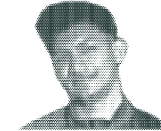

# Kaustubh Dalvi

<picture>
  <source media="(prefers-color-scheme: dark)" srcset="https://raw.githubusercontent.com/Kaustubhdalvi/Kaustubhdalvi/main/assets/portrait-dots-dark.svg">
  
</picture>

I build reinforcement learning environments for coding agents and write the Python tests that score their work. When a score surprises me, I trace the agent’s steps to see what the test rewarded.

I’m exploring how mixtures of specialized models can work together in the next generation of computing.

  
  

**[Puzzle notebook ↗](https://kaustubhdalvi.github.io/Kaustubhdalvi/puzzles.html)** · [Play the chess puzzle ♞](https://kaustubhdalvi.github.io/Kaustubhdalvi/puzzles.html#chess)

## Pip’s yard

<!-- yard:start -->
<picture>
  <source media="(prefers-reduced-motion: no-preference)" srcset="https://raw.githubusercontent.com/Kaustubhdalvi/Kaustubhdalvi/main/assets/pip-ball-yard.gif">
  
</picture>
<!-- yard:end -->

[Watch the live yard](https://kaustubhdalvi.github.io/Kaustubhdalvi/yard.html) · [Claim the free bowl](https://github.com/Kaustubhdalvi/Kaustubhdalvi/issues/new?template=feed.yml) · [Extra meal (preview)](https://kaustubhdalvi.github.io/Kaustubhdalvi/meals.html) · [Suggest my next book](https://github.com/Kaustubhdalvi/Kaustubhdalvi/issues/new?template=book.yml)

Everyone shares one free bowl every 12 hours. The first eligible feeder earns a point and sends a visitor to feed and play with the puppies for one minute.

<!-- community:start -->

**Feeding leaderboard** · The first feeding spot is open.

**Bookshelf** · Be the first to suggest a book.

<!-- community:end -->

<picture>
  <source media="(prefers-reduced-motion: no-preference)" srcset="https://raw.githubusercontent.com/Kaustubhdalvi/Kaustubhdalvi/main/assets/wave.svg">
  
</picture>
