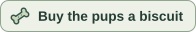

<h1 align="center">
  <picture>
    <source media="(max-width: 740px)" srcset="https://raw.githubusercontent.com/Kaustubhdalvi/Kaustubhdalvi/main/assets/profile-masthead-compact.svg">
    
  </picture>
</h1>

I build reinforcement learning environments for coding agents and write the Python tests that score their work. When a score surprises me, I trace the agent’s steps to see what the test rewarded.

I’m exploring how mixtures of specialized models can work together in the next generation of computing.

  
  

## Pip’s yard

<!-- yard:start -->

<picture>
  <source media="(prefers-reduced-motion: no-preference)" srcset="https://raw.githubusercontent.com/Kaustubhdalvi/Kaustubhdalvi/main/assets/pip-guest-yard.gif">
  
</picture>

  
  

<!-- yard:end -->

<!-- community:start -->

**Bookshelf** · 

Garden leaderboard · 1 recorded visit

Free leaderboard entries are at least 12 hours apart.

| Rank | Garden visitor | Meals |
| ---: | :--- | ---: |
| 1 🥇 | [@Kaustubhdalvi](https://github.com/Kaustubhdalvi) | 1 |

<!-- community:end -->

  
  
  

<picture>
  <source media="(prefers-reduced-motion: no-preference)" srcset="https://raw.githubusercontent.com/Kaustubhdalvi/Kaustubhdalvi/main/assets/wave.svg">
  
</picture>
